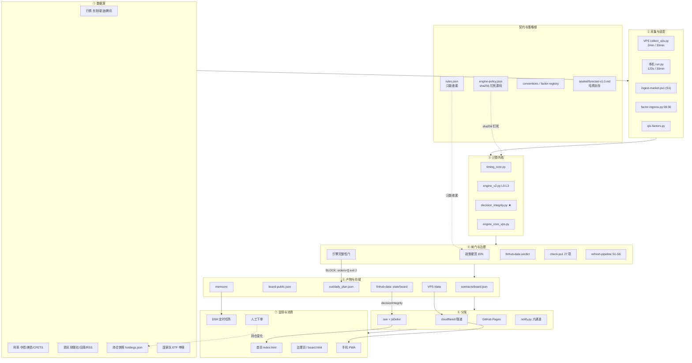

# 投资体系架构（2026-11-07 实测版）

配套图：
- `overview.png` —— 总架构（七层 + 契约栏 + 审计栏 + 四条铁律）
- `gates.png` —— 三个完整性闸门（引擎 / 数据仓 / 页面）与当前状态

---

## 一、主线一句话

> **VPS 算行情，本机 PowerShell 算政策与看板，GitHub 只存公开数据和页面。**
> 没有任何 GitHub Actions 参与生产计算；唯一例外是 finhub-data 用 Actions 生成「决策完整性 verdict」。
> 引擎（Python）只产出**建议与订单清单**，没有实盘权限；下单永远由人完成。

产物从产生到手机上看到，走两条独立的路：

| 路 | 链路 | 特点 |
|---|---|---|
| 手机实时通道 | VPS `collect_vps.py` → `state.json` → cloudflared 隧道 → `/data/state.json`（公开）/ `personal.json`（口令 401） | 交易时段 2 分钟一刷；个人层需口令 |
| 公开静态通道 | 本机流水线 S2 导出 → 脱敏 → S4 用内容 API 原地 PUT 到 finhub-data → GitHub Pages（`index.html` / `board.html`）读 raw/jsDelivr | 30 分钟一刷；只含公开层 |

---

## 二、七层拆开看

### ① 数据源
行情（东财/新浪/腾讯，指数 + ETF 日线）、利率与汇率（中债、美债 Treasury、CFETS 中间价）、资讯（财联社/华尔街见闻/RSS/研报）、持仓快照（用户上传，落 `<DSH_HOME>/finwatch/holdings.json`）、国家队（ETF 申赎/份额）。

### ② 采集与适配
- VPS：`collect_vps.py` + `overseas.py`，systemd `finhub-collect` 常驻，A 股时段 2 分钟 / 其余 30 分钟。
- 本机：`run.py`（8787 常驻，09:15–15:10 每 120 秒）、`ingest-market.ps1`（流水线 S1，行情落 `data/nav`）、`factor-ingress.py`（08:30 三因子）、`qis-factors.py`（价量因子，研究级）。

### ③ 计算内核
- `timing_core.py`（TimingEngine：六阶段 / 机会与风险评分 / 逐条证据）
- `engine_v2.py`（L0 持仓 → L1 信号 → L2 政策 → L3 订单；**金额只在政策层产生**）
- `decision_integrity.py`（完整性门，**本轮已接进生产**）
- VPS 侧 `engine_core_vps.py`：只把新浪取数换成腾讯，算法一行不改
- 研究级：`backtest.py` / `dyn_sim.py` / `policy_stress.py`，不进生产路径

### ④ 闸门与治理
政策硬顶 15%（`HARD_MAX` 是权限根，外部 rules 只能收紧）· 引擎完整性门 · finhub-data verdict · `check.ps1` 27 项（C0–C26）· `refresh-pipeline.ps1` S1–S6。

### ⑤ 产物与存储
本机 `contracts/board.json`（全量，含金额）/ `board-public.json`（唯一公开件）/ `metrics.json` / `position-history.json` / `out/daily_plan.json` / `out/decision_log.jsonl`；公开仓 finhub-data（`state.json` + `board.json`）；VPS `<VPS>/data/*`；长期记忆 memcore。

### ⑥ 分发
cloudflared 隧道（VPS serve.py：公开 state、`/api/holdings` 需 `X-FH-Key`、personal 401）· GitHub raw + jsDelivr · GitHub Pages · notify.py 六通道推送。

### ⑦ 呈现与消费
首页（决策条 BLOCK 灯 / 现在什么情况 / 今日信号卡 / 我的持仓）· 治理页与独立看板 · 手机 PWA · DSH 定时任务与会话 · 人工执行。

---

## 三、契约与权威（左栏）

| 契约 | 作用 | 机制 |
|---|---|---|
| `contracts/engine-policy.json` | 政策的唯一权威出口 | 由 `tools/export-engine-policy.ps1` 从源码解析生成，`_source.sha256` 钉死 `timing_core.py` / `engine_v2.py` |
| `<DSH_HOME>/finwatch/rules.json` | 个人政策 | 只能收紧硬顶，不能放宽 |
| `contracts/conventions.json`、`factor-registry.json` | 阈值与因子登记 | 改口径必须先登记，否则自检红 |
| `<预注册目录>/…` | 预注册演算 | SHA-256 封存，禁止回改；更正只写 ERRATA |
| `BOUNDARIES.md` / `ERRATA.md` | 边界断言与更正台账 | 口径漂移 = 自检红；更正只追加 |

---

## 四、产物矩阵（谁写 / 多久 / 是否公开）

| 产物 | 唯一写者 | 频率/触发 | 公开性 | 下游 | 自检点 |
|---|---|---|---|---|---|
| `contracts/board.json` | `tools/export-board.ps1`（S2） | 每 30 分钟 / 手动 | 本机私有（含金额与内部路径） | 脱敏、通知、board_sync | S3 零金额、C24 时效重算 |
| `contracts/board-public.json` | `tools/export-board-public.ps1` | 同上 | **唯一允许公开** | finhub-data、VPS | 白名单脱敏 + 二扫泄漏即中止 |
| `contracts/metrics.json` | 审计链（只追加 derived） | 随判定 | 治理看板 | 看板/汇总 | C4 authority 唯一、C6 漂移 |
| `contracts/position-history.json` | `export-position-history.ps1`（S2） | 每次 S2 | 公开层可取 | 看板漂移对比 | 3 条、同 date 覆盖、升序 |
| `contracts/factors-live.json` | `tools/factor-ingress.py` | 每日 08:30 | 私有 | 链式推演 | 只由脚本生产 |
| `contracts/factors-qis.json` | `tools/qis-factors.py` | 每次 S2 前 | 公开层可取 | 看板 qis 段 | 研究级，不推仓位 |
| `out/daily_plan.json` | `engine_v2.py` | 手动/按需 | 私有 | publish、forward_track | 完整性门 PASS 才出单 |
| `out/decision_log.jsonl` | `finwatch_publish.py` | 同上 | 私有 | 事后验收 | 无 PASS 拒写 |
| `finhub-data/state.json` | 本机 `sync_data.py`（gh api PUT） | 随流水线 | 公开（已脱敏） | Pages、隧道 | 禁用 git push -f |
| `finhub-data/board.json` | 流水线 S4（内容 API 原地 PUT） | 每 30 分钟 | 公开（脱敏件） | Pages | S5 线上一致性校验 |
| `finhub-data` 的 `decisionIntegrity` | Actions `board-integrity.yml` | push 触发 | 公开 | 页面 BLOCK 门 | 回归测试 + --check |
| VPS `<VPS>/data/*.json` | VPS 常驻 + `board_sync.py` | 2/30 分钟 + 手动 | 隧道内 | 手机 | 隧道鉴权、金额二扫 |

**三条写者纪律**：① finhub-data 只允许内容 API 原地 PUT，禁 `git push -f`（否则旧副本覆盖新板——这是 11-04 假成功的根因）；② 每个产物只有一个写通道；③ 公开件必须过脱敏 + 零金额自检。

---

## 五、三个完整性闸门（当前状态）

| 闸门 | 位置 | 判定 | 不通过的表现 | 当前 |
|---|---|---|---|---|
| A 引擎 | `engine_v2.py` + `decision_integrity.py` | 持仓≤36h、四指数同日、行情≤4天、字段级（市值/现金非 NaN/字符串/负数） | `orders=[]`、`error` 置位、CLI exit 2 | **已接生产**；自检 9/9 PASS；真实快照约 48h → 会 BLOCK |
| B 数据仓 | GitHub Actions `board-integrity.yml` | board 24h、持仓 36h、四指数、行情 4 天、政策未决项、硬顶≤15% | 写回 `decisionIntegrity.status=BLOCK` | **已上线**；当前 BLOCK（checkedAt 2026-11-07 22:14:23+08） |
| C 页面 | `index.html` / `board.html` 的 `decisionIntegrityFor` | 无 PASS、超 24h、未来>5min、持仓>1.5 天、stale | 决策条 BLOCK、金额与执行单遮蔽 | **已上线**；个人层三处入口补丁在分支 `fix/integrity-personal-layer`，未合并 |

> 注意：**BLOCK 不等于 HOLD**。完整性没通过时，不产生建议、不产生订单、不写决策记忆；旧动作不得当作当前建议。

---

## 六、定时任务（真实在跑的）

| 任务 | 时间 | 做什么 |
|---|---|---|
| 数据实时性流水线 | 每 30 分钟 | `refresh-pipeline.ps1` S1–S6（退出码 0/2/1/3） |
| 三因子采集 | 每日 08:30 | `factor-ingress.py` → `factors-live.json` |
| 每日链式推演 | 每日 08:45 | 读 `factors-live/qis`，更新 `chain-model.md` 与 `daily-log` |
| 三会话产出汇总 | 每日 16:05 | `brief.ps1` → `_audit/brief/YYYY-MM-DD.md` |
| 理财总仓周检 | 每周日 20:00 | `check.ps1` 27 项 + 日档连续性 + 提醒逾期 |
| VPS 采集 | 2 分钟 / 30 分钟 | `collect_vps.py` → `state.json` |
| 本机常驻 | 120 秒 / 30 分钟 | `run.py` 8787 |

---

## 七、当前断点（如实说）

1. 线上 Pages 仍是 GPT 那版：BLOCK 可见，但**个人层解锁后仍显示金额/需减/执行单**（P0-3 已修在分支，未合并）。
2. 线上 BLOCK 来自持仓快照约 2 天（>36h）+ 4 条政策未决项，不是引擎门在起作用；引擎门只影响 `out/daily_plan.json`，不影响页面数据。
3. `forward_track.py` 不判完整性；publish 仍信任 plan 自报的 PASS（P1，未修）。
4. finhub-data workflow：`--check` 在 `--write` 之后恒真、不校验 `checkedAt` 时效、publisher 的 actor 守卫可静默 skip、烘焙 `dataAgeDays` 可谎报 PASS（P1）。
5. UI 首页两个决策大字徽章被 `.trim` 类名冲突吃掉、仓位%未遮、缓存无 TTL（P1/P2）。

---

## 八、可编辑版（Mermaid）

---

## 九、证据来源（不列本机路径）

- 架构依据：本机生产链路溯源文档（2026-11-06）+ 各脚本头部注释 + 定时任务清单实测
- 三闸门当前值：`finhub-data` 的 `board.json` 里 `decisionIntegrity.checkedAt` / `issues`
- 引擎侧：`engine-policy.json._source.sha256` 与源码逐字节一致
- 审计与修复记录：私有文档库（不在公开仓）
